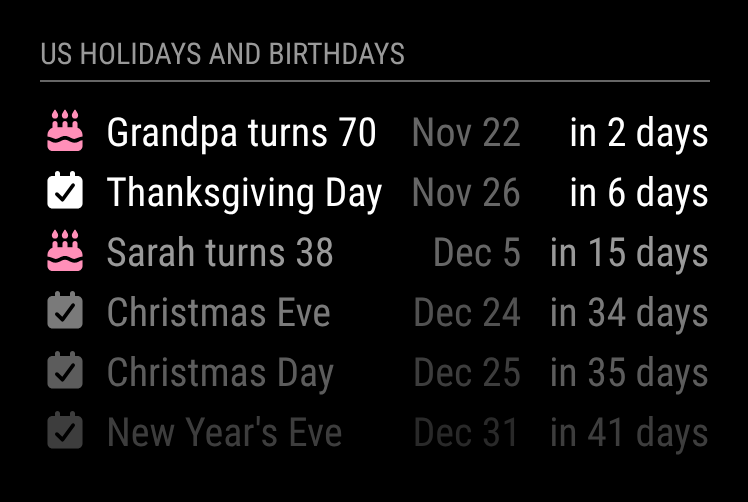
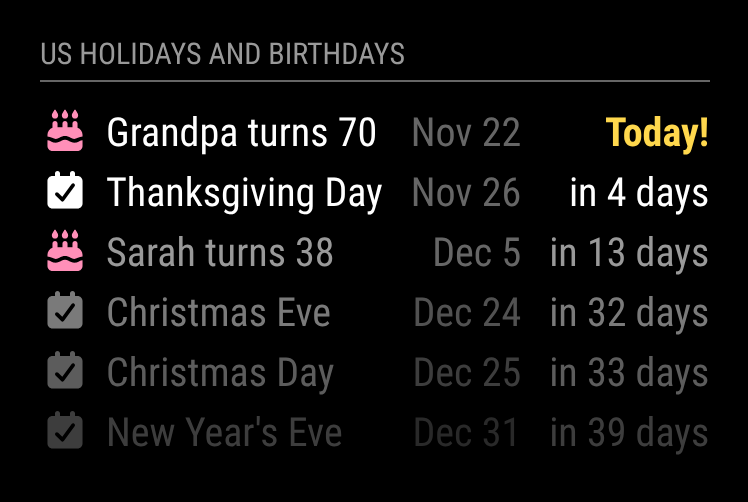
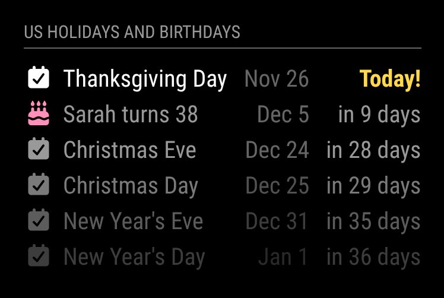

# MMM-Cal

A [MagicMirror²](https://github.com/MagicMirrorOrg/MagicMirror) module that lists upcoming US holidays
**and birthdays** with a countdown: **Today!**, **Tomorrow**, or **in 6 days**.



- Holiday dates are calculated on the mirror itself, including the ones that move every year
  (Thanksgiving, Easter, Memorial Day, Mother's Day and so on)
- No internet feed, no API key, no npm packages
- Updates itself at midnight
- Birthdays come from a plain text file you keep in the module folder, with ages if you add the birth year
- Add other dates of your own and hide holidays you don't care about

---

## Screenshots

| Holidays and birthdays mixed by date | A birthday today | A holiday today |
|:---:|:---:|:---:|
|  |  |  |

Holidays within a week (`highlightDays`) are shown brighter, and the list fades out further down.
Birthdays get a 🎂 icon, and the day itself shows **Today!** in yellow.

---

## Install

```bash
cd ~/MagicMirror/modules
git clone https://github.com/cowboysdude/MMM-Cal
```

**Do I need to run `npm install`?** No. The module has no dependencies.

---

## Add it to your config

In `~/MagicMirror/config/config.js`, inside `modules: [ ... ]`:

```js
{
  module: "MMM-Cal",
  header: "US Holidays and Birthdays",
  position: "top_left"
},
```

That's all you need. Restart MagicMirror to see it.

If you were using the built-in `calendar` module only for US holidays, you can remove it. This module
replaces it.

### A fuller example

```js
{
  module: "MMM-Cal",
  header: "US Holidays and Birthdays",
  position: "top_left",
  config: {
    maxHolidays: 8,
    exclude: ["Groundhog Day", "Flag Day"],
    customHolidays: [
      { name: "Mom's Birthday", date: "03-14" },      // every year
      { name: "Vacation!", date: "2027-07-10" }       // one time only
    ],
    labels: { today: "Today!", tomorrow: "Tomorrow", inDays: "{n} days" }
  }
},
```

---

## Birthdays

Birthdays are read from **`birthdays.txt`** in the module's folder
(`~/MagicMirror/modules/MMM-Cal/birthdays.txt`). Edit it with any text editor. Put one birthday per
line, as the date, a comma, then the name:

```
# Lines starting with # are notes and are ignored. Blank lines are fine too.

03-14, Mom
07-02, Dad
1956-11-22, Grandpa
1988-12-05, Sarah
```

| Line | Shows on the mirror |
|---|---|
| `03-14, Mom` | **Mom's Birthday** every March 14 |
| `1956-11-22, Grandpa` | **Grandpa turns 70** (the age is worked out from the birth year) |

- Birthdays are mixed in with the holidays by date, and get a 🎂 cake icon instead of the ✓.
- **No restart needed.** The file is read again every hour and at midnight. Reload the mirror page if
  you want to see a change straight away.
- A birthday on **Feb 29** shows on Feb 28 in years that aren't leap years.
- A line that isn't in the right format is skipped, and a note about it goes in the browser console.
- To use a different file name, set `birthdaysFile: "family.txt"`. Set `birthdaysFile: ""` to turn
  birthdays off.
- To hide one person for a while, add their name to `exclude`, e.g. `exclude: ["Uncle Bob"]`.
- To show more lines when birthdays crowd the list, raise `maxHolidays`.

---

## Options

| Option | Default | What it does |
|---|---|---|
| `maxHolidays` | `6` | How many upcoming holidays to list. |
| `maxDays` | `365` | Only list holidays within this many days. |
| `showDate` | `true` | Show the date next to the holiday name. |
| `dateFormat` | `{ month: "short", day: "numeric" }` | How the date looks. Uses the `locale` at the top of `config.js`. For "Thu, Nov 26" use `{ weekday: "short", month: "short", day: "numeric" }`. |
| `highlightDays` | `7` | Holidays this many days away or closer are shown brighter. |
| `fade` | `true` | Fade holidays further down the list. |
| `fadePoint` | `0.5` | Where the fade starts: `0` = top of the list, `1` = bottom. |
| `showSymbol` | `true` | Show an icon in front of each holiday. |
| `symbol` | `"calendar-check"` | Any [Font Awesome](https://fontawesome.com/icons) icon name, e.g. `"star"`, `"gift"`. |
| `exclude` | `[]` | Holiday names or birthday names to hide, e.g. `["Halloween", "Uncle Bob"]`. |
| `customHolidays` | `[]` | Other dates of your own, set in `config.js`. `"MM-DD"` repeats every year; `"YYYY-MM-DD"` shows once. (Birthdays are easier in `birthdays.txt`.) |
| `birthdaysFile` | `"birthdays.txt"` | Text file of birthdays in the module folder. `""` turns birthdays off. |
| `birthdaySymbol` | `"birthday-cake"` | Font Awesome icon used for birthdays. |
| `showAge` | `true` | Show "turns 70" when the birth year is in the file. Set `false` to always show "Name's Birthday". |
| `includeObserved` | `false` | Also list the "(observed)" day when a federal holiday falls on a weekend. |
| `labels` | see below | The wording. Defaults: `today: "Today!"`, `tomorrow: "Tomorrow"`, `inDays: "in {n} days"`, `birthday: "{name}'s Birthday"`, `turns: "{name} turns {age}"`. |

## Holidays included

New Year's Day, Martin Luther King Jr. Day, Groundhog Day, Valentine's Day, Presidents' Day,
St. Patrick's Day, Good Friday, Easter Sunday, Mother's Day, Memorial Day, Flag Day, Father's Day,
Juneteenth, Independence Day, Labor Day, Columbus Day, Halloween, Veterans Day, Thanksgiving Day,
Christmas Eve, Christmas Day and New Year's Eve.

## Styling

Every rule is scoped to `.MMM-Cal`, so it won't change other modules. To restyle it, add rules to
`~/MagicMirror/css/custom.css`:

```css
.MMM-Cal .countdown { color: #7fd1ff; }          /* countdown color */
.MMM-Cal .today .countdown { color: #ff5a5a; }   /* "Today!" color */
.MMM-Cal .date { display: none; }                /* hide the date column */
.MMM-Cal .birthday .symbol { color: #ffd84d; }   /* cake icon color */
.MMM-Cal .birthday .title { color: #ffb3cf; }    /* birthday names in pink */
```

## License

MIT
